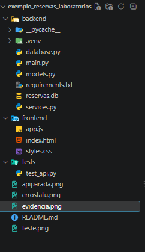
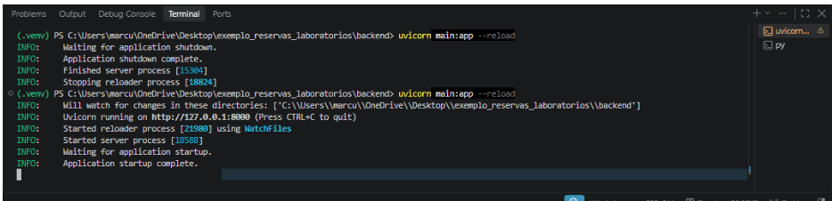
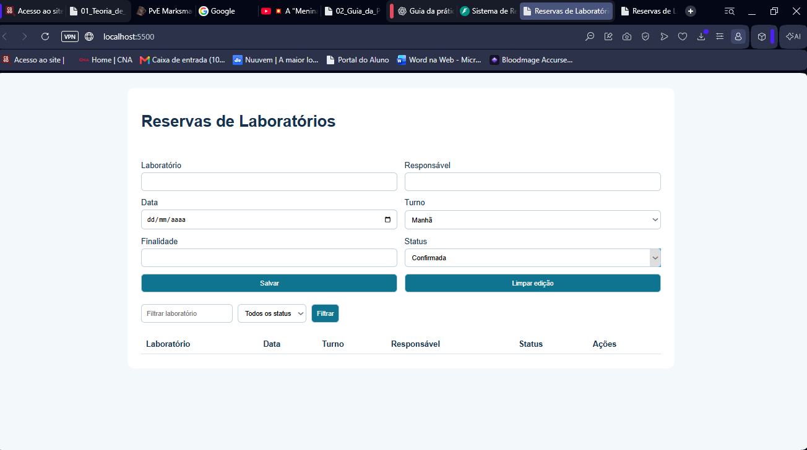
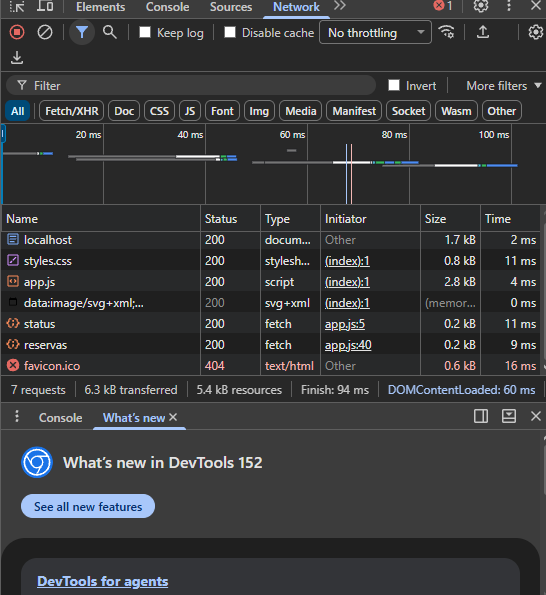
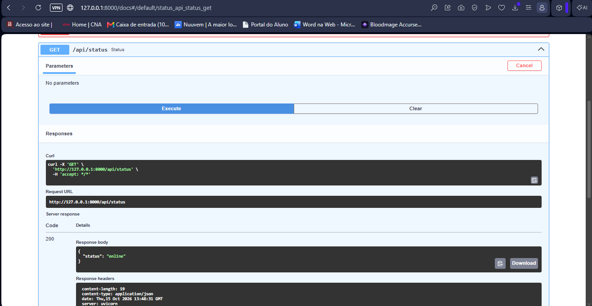
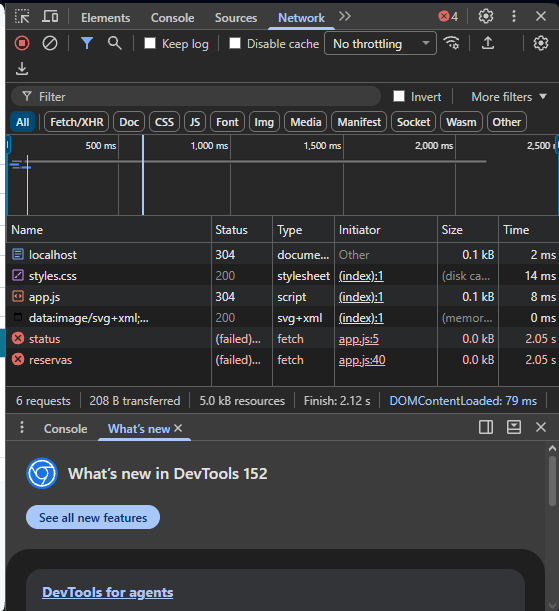
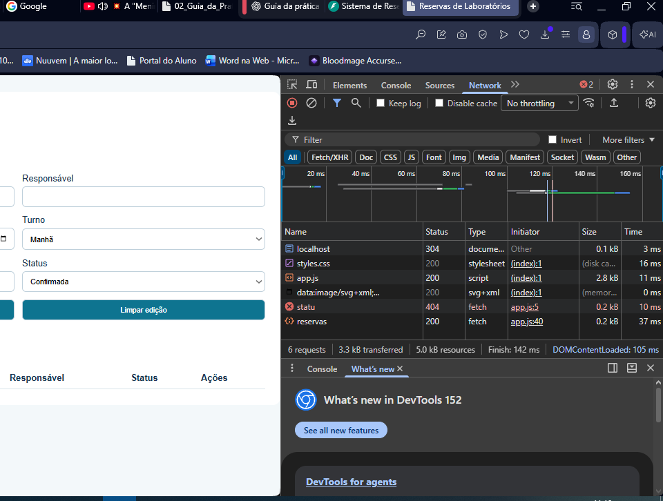

# Relatório da Prática — Encontros 1, 2 e 3
## Sistema de Reservas de Laboratórios

**Disciplina:** Engenharia de Software

## 1. Objetivo da prática

O objetivo da prática foi executar o Sistema de Reservas de Laboratórios e entender como o frontend se comunica com o backend. No segundo encontro, foi adicionado o campo de quantidade de alunos, com validação dos valores entre 1 e 40.

No terceiro encontro, o sistema foi aprimorado para manter os dados salvos no banco SQLite, permitir consultas e exclusões, aplicar filtros e impedir reservas conflitantes para o mesmo laboratório, data e turno.

## 2. Arquivos do projeto e suas funções

| Arquivo | Função |
|---|---|
| `backend/main.py` | Cria a API e define as rotas do sistema, incluindo o tratamento de erros HTTP. |
| `backend/requirements.txt` | Contém as bibliotecas necessárias para executar o backend. |
| `frontend/index.html` | Cria a estrutura da página e do formulário. |
| `frontend/styles.css` | Define a aparência da página. |
| `frontend/app.js` | Envia os dados para a API, exibe as reservas, aplica filtros e permite editar e excluir registros. |
| `backend/database.py` | Configura a conexão com o SQLite e cria a tabela de reservas. |
| `backend/models.py` | Define os dados necessários para uma reserva e suas validações com Pydantic. |
| `backend/services.py` | Contém as operações de banco de dados para criar, consultar, listar, atualizar e excluir reservas, além da verificação de conflitos. |
| `tests/test_api.py` | Arquivo destinado aos testes automatizados da API. |
| `reservas.db` | Banco de dados SQLite localizado na pasta principal do projeto. |

## 3. Evidências da prática

### 3.1. Evidências do Encontro 1

**Evidência A — Estrutura do projeto**

Mostra as pastas e os arquivos do projeto no VS Code.

**Evidência B — Inicialização do backend**

Mostra o servidor Uvicorn funcionando.

**Evidência C — Interface do sistema**

Mostra a página do sistema aberta no navegador.

**Evidência D — Requisições da API**

Mostra as requisições feitas pelo navegador na aba Network.

**Evidência E — Resposta da API**

Mostra a rota `/api/status` retornando o status online.

**Evidência F1 — API parada**

Mostra o que acontece quando o servidor da API é desligado.

**Evidência F2 — URL incorreta**

Mostra o erro 404 ao acessar uma rota escrita incorretamente.

**Evidência F3 — Abertura direta do HTML**

Mostra a abertura do arquivo HTML diretamente pelo navegador.

### 3.2. Evidências do Encontro 2

**Evidência B — Formulário atualizado**

Arquivo: `evidencias/EvidenciaB_frontaberto.png`

Mostra o campo de quantidade de alunos no formulário e a coluna correspondente na tabela de reservas.

**Evidência C — Cadastro realizado com sucesso**

Arquivo: `evidencias/EvidenciaC_25_201.png`

Mostra a criação de uma reserva pela API, com resposta `201 Created` e o campo `quantidade_alunos` no resultado.

**Evidência C — Teste com 41 alunos**

Arquivo: `evidencias/EvidenciaC_41_422.png`

Mostra que a API rejeitou o valor 41 e retornou `422 Unprocessable Entity`, pois o limite máximo permitido é 40 alunos.

**Evidência C — Campo obrigatório ausente**

Arquivo: `evidencias/EvidenciaC_campoausente_422.png`

Mostra que a API retornou `422 Unprocessable Entity` quando o campo `quantidade_alunos` não foi enviado.

### 3.3. Evidências do Encontro 3

**Evidência — Persistência após reiniciar a API**

Arquivo: `evidencias/Evidencia_pos_reinicio_encontro3.png`

Mostra que a reserva continuou disponível após o reinício da API, comprovando a persistência dos dados no SQLite.

**Evidência — Consulta de reserva inexistente (404)**

Arquivo: `evidencias/Evidencia_404_naoencontrada_encontro3.png`

Mostra a consulta de uma reserva com ID inexistente, que retornou `404 Not Found` e a mensagem de que a reserva não foi encontrada.

**Evidência — Conflito de horário (409)**

Arquivo: `evidencias/Evidencia_conflito409_encontro3.png`

Mostra a tentativa de cadastrar outra reserva para o laboratório `lab 05`, na data `2026-12-13`, no turno `noite`. A API retornou `409 Conflict`, impedindo a duplicação do horário.

**Evidência — Filtros do sistema**

Arquivo: `evidencias/Evidencia_filtro_encontro3.png`

Mostra o funcionamento da pesquisa de reservas por filtros.

## 4. Como os dados funcionam no sistema

1. O navegador abre a página do sistema.
2. O JavaScript coleta os dados preenchidos no formulário.
3. Os dados são enviados em formato JSON para a API.
4. O backend valida os dados recebidos.
5. O serviço verifica se existe conflito de horário e executa a operação solicitada.
6. Os dados são armazenados ou consultados no banco SQLite, localizado na pasta principal do projeto.
7. A API retorna uma resposta HTTP ao frontend.
8. O JavaScript atualiza a tabela para mostrar as reservas.

No segundo encontro, esse processo passou a incluir a quantidade de alunos. No terceiro encontro, foram acrescentados os filtros, a consulta por ID, a exclusão e a verificação de conflitos.

## 5. Perguntas de verificação

### 5.1. Questões do Encontro 1

**17. `app = FastAPI()` inicia o servidor?**

Não. Essa linha cria a aplicação. O Uvicorn é responsável por iniciar o servidor e receber as requisições.

**18. Qual processo atende à porta 8000?**

O Uvicorn, que executa o backend.

**19. Qual processo atende à porta 5500?**

O servidor HTTP iniciado com o comando `py -m http.server 5500`, que disponibiliza os arquivos do frontend.

**20. Onde a rota `/api/status` é definida?**

No arquivo `backend/main.py`.

**21. Como comprovar que a requisição chegou ao backend?**

Podemos verificar a requisição na aba Network do navegador e também observar os registros no terminal do Uvicorn.

**22. Por que abrir a pasta raiz no VS Code ajuda?**

Porque permite visualizar todos os arquivos e entender melhor como o frontend e o backend se relacionam.

**23. Qual é a diferença entre Console, Network e terminal da API?**

- **Console:** mostra mensagens e erros do JavaScript.
- **Network:** mostra as requisições e respostas HTTP.
- **Terminal da API:** mostra os registros e erros do backend.

### 5.2. Questões do Encontro 2

**5. Por que a validação HTML não substitui a validação Pydantic?**

Porque a validação HTML funciona no navegador e pode ser contornada. O Pydantic valida os dados recebidos pelo backend, mesmo quando a requisição é feita diretamente à API.

**6. Por que utilizar `JSON.stringify()`?**

Porque essa função transforma o objeto JavaScript em uma string JSON que pode ser enviada na requisição HTTP.

**7. Onde o código 201 é definido?**

No arquivo `backend/main.py`, na rota `POST /api/reservas`, por meio de `status_code=201`. Ele indica que a reserva foi criada com sucesso.

**8. O que aconteceria se o JavaScript enviasse `quantidadeAlunos` em vez de `quantidade_alunos`?**

A API não reconheceria esse nome como o campo esperado. Como `quantidade_alunos` é obrigatório, a requisição retornaria erro 422.

**9. Como comprovar que a requisição chegou ao servidor?**

Podemos verificar a requisição na aba Network e observar o registro correspondente no terminal do Uvicorn.

### 5.3. Questões do Encontro 3

**1. Por que commit é necessário depois de INSERT, UPDATE e DELETE?**

O `commit` confirma a transação no banco de dados e grava as alterações. Sem essa confirmação, as mudanças podem não ser persistidas.

**2. Por que o Pydantic não detecta sozinho o conflito de horário?**

Porque o Pydantic valida os dados recebidos, como tipos, campos obrigatórios e limites. Para identificar se já existe uma reserva para o mesmo laboratório, data e turno, é necessário consultar o banco de dados e aplicar uma regra de negócio.

**3. Qual diferença existe entre `/reservas/5` e `/reservas?laboratorio=Lab`?**

`/reservas/5` identifica uma reserva específica pelo ID. Já `/reservas?laboratorio=Lab` consulta a coleção de reservas usando um filtro pelo nome do laboratório.

**4. Por que DELETE retorna 204 sem JSON?**

O código `204 No Content` indica que a operação foi concluída com sucesso e que não há conteúdo a retornar no corpo da resposta.

## 6. Integrantes do grupo e responsabilidades

| Integrante | Responsabilidade |
|---|---|
| **Andrew Lippy de Mattos Pereira** | Desenvolvimento do backend e das rotas da API. |
| **Cauã Pereira Menezes** | Desenvolvimento da página, do HTML e do CSS. |
| **Marcus Vinicius Alves de Oliveira** | Integração entre frontend e backend e verificação das requisições. |
| **Matheus Prates Gaspar Silva** | Testes do sistema e verificação das respostas da API. |
| **Nathan de Faria Alves Alvarenga** | Documentação do projeto e organização do README. |
| **Roberto Kleber da Fonseca Ponce Junior** | Organização das evidências e apoio à revisão do relatório. |

### Trabalho em grupo

O projeto foi desenvolvido com a participação dos integrantes, dividindo as tarefas para facilitar a programação, os testes e a documentação. No terceiro encontro, foram realizadas melhorias na persistência, nas consultas, nos filtros e no tratamento de conflitos de horário.

## 7. Melhorias futuras

Como melhorias, o sistema pode receber novos testes automatizados, mensagens de erro mais claras, filtros adicionais e outras funcionalidades para facilitar o uso e evitar conflitos de horários.

## 8. Conclusão

Durante os três encontros, foi possível entender melhor como o frontend se comunica com o backend e como os dados são enviados, validados e armazenados no banco de dados.

No segundo encontro, foi adicionado o campo de quantidade de alunos, permitindo cadastrar reservas com valores entre 1 e 40. Os testes mostraram que a API aceita dados válidos e rejeita valores fora do limite ou quando o campo obrigatório não é enviado.

No terceiro encontro, o sistema passou a utilizar o banco SQLite localizado fora da pasta `backend`, mantendo os dados após o reinício da API. Também foram testadas a consulta por ID, as respostas de erro `404` e `409`, os filtros e a exclusão de reservas.

A prática ajudou a compreender a importância de integrar o frontend, o backend e o banco de dados, além de aplicar validações e regras de negócio para manter o funcionamento correto do sistema.