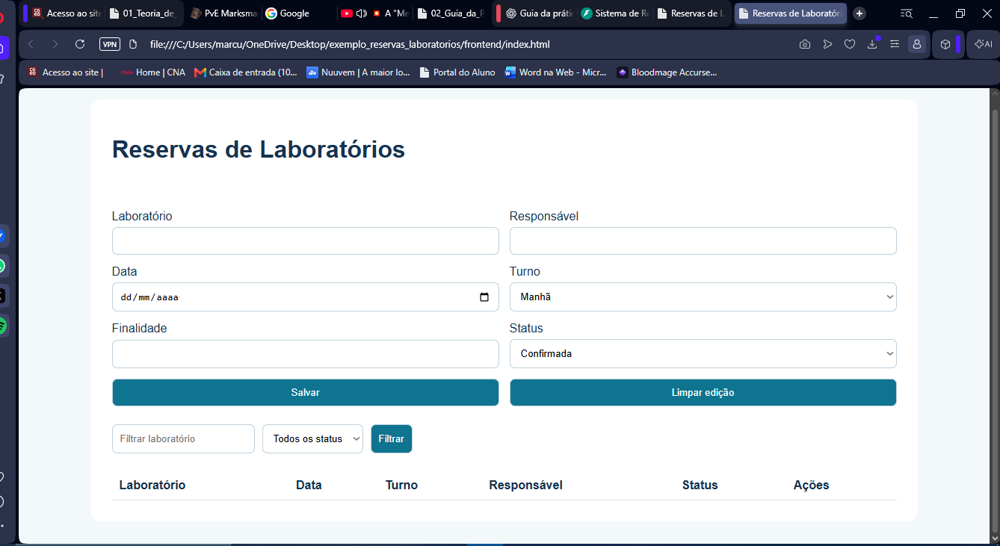

<<<<<<< HEAD
# Relatório da Prática — Encontro 1
## Sistema de Reservas de Laboratórios

## Disciplina:** Engenharia de Software  

## 1. Objetivo da prática

Preparar o ambiente de desenvolvimento, executar o Sistema de Reservas de Laboratórios e verificar a integração entre o navegador, o JavaScript e a API desenvolvida com FastAPI.

## 2. Identificação das camadas e dos arquivos

| Arquivo | Camada | Responsabilidade |
|---|---|---|
| `backend/main.py` | API | Cria a aplicação FastAPI e define as rotas, incluindo `/api/status`. |
| `backend/requirements.txt` | Ambiente | Declara as dependências Python. |
| `frontend/index.html` | Apresentação | Estrutura a página. |
| `frontend/styles.css` | Apresentação | Define a aparência e a disposição dos elementos. |
| `frontend/app.js` | Integração | Faz requisições HTTP e atualiza a interface. |
| `backend/database.py` | Persistência | Gerencia operações relacionadas ao banco de dados. |
| `backend/models.py` | Modelagem | Define os modelos utilizados pela aplicação. |
| `backend/services.py` | Regras de negócio | Implementa operações relacionadas às reservas. |
| `tests/test_api.py` | Testes | Contém testes automatizados da API. |

## 3. Evidências da prática

### Evidência A — Estrutura do projeto

A imagem apresenta a organização das pastas e dos arquivos no VS Code.

### Evidência B — Inicialização do back-end

O terminal mostra o Uvicorn em execução e a aplicação FastAPI inicializada.

### Evidência C — Interface do sistema

A interface do Sistema de Reservas de Laboratórios foi aberta pelo servidor HTTP na porta 5500.

### Evidência D — Integração entre front-end e API

A aba Network mostra as requisições `status` e `reservas` com resposta HTTP 200.

### Evidência E — Resposta da API

A rota `GET /api/status` retornou HTTP 200 e o JSON `{"status":"online"}`.

### Evidência F1 — API parada

Com o Uvicorn interrompido, as requisições à API falharam, demonstrando a dependência do front-end em relação ao back-end.

### Evidência F2 — URL incorreta

A chamada à rota incorreta `/api/statu` retornou HTTP 404, enquanto a consulta de reservas continuou respondendo com HTTP 200.

### Evidência F3 — Abertura direta do HTML

O arquivo `index.html` foi aberto diretamente pelo endereço `file://`, permitindo comparar esse acesso com a utilização do servidor HTTP.

## 4. Percurso dos dados

1. O navegador carrega `frontend/index.html` e aplica os estilos de `frontend/styles.css`.
2. O JavaScript de `frontend/app.js` executa requisições HTTP para consultar o status da API e as reservas.
3. O servidor Uvicorn recebe as requisições e executa as rotas definidas em `backend/main.py`.
4. A API retorna respostas em JSON, incluindo `{"status":"online"}` na rota de status.
5. O JavaScript interpreta as respostas e utiliza os dados para atualizar a interface.

## 5. Perguntas de verificação

**17. `app = FastAPI()` inicia o servidor? Justifique.**

Não. Essa instrução cria a aplicação FastAPI. O servidor é iniciado pelo Uvicorn, que executa a aplicação e atende às requisições HTTP.

**18. Qual processo atende à porta 8000?**

O processo Uvicorn, responsável por executar a aplicação FastAPI.

**19. Qual processo atende à porta 5500?**

O servidor HTTP simples iniciado com o comando `py -m http.server 5500`, responsável por disponibilizar os arquivos do front-end.

**20. Onde a rota `/api/status` é definida?**

No arquivo `backend/main.py`, por meio do decorador `@app.get("/api/status")`.

**21. Qual evidência comprova que a requisição alcançou o back-end?**

A requisição aparece na aba Network com a URL da API e resposta HTTP 200. O terminal do Uvicorn também registra as requisições recebidas.

**22. Por que abrir a pasta raiz no VS Code facilita a compreensão?**

Porque permite visualizar as camadas do sistema em conjunto, compreender a relação entre os arquivos e identificar como o front-end se comunica com o back-end.

**23. Qual é a diferença entre Console, Network e terminal da API?**

- **Console:** apresenta mensagens e erros do JavaScript.
- **Network:** mostra requisições HTTP, endereços, métodos, respostas e códigos de status.
- **Terminal da API:** apresenta os registros do servidor Uvicorn e da aplicação Python.

## 6. Composição do grupo e responsabilidades

## Integrantes do grupo e divisão de responsabilidades

| Integrante | Responsabilidade |
|---|---|
| **Andrew Lippy de Mattos Pereira** | Desenvolvimento do backend, com implementação e manutenção das rotas da API utilizando FastAPI. |
| **Cauã Pereira Menezes** | Desenvolvimento do frontend, incluindo a estrutura HTML, a estilização CSS e a interface do sistema. |
| **Marcus Vinicius Alves de Oliveira** | Integração entre frontend e backend, comunicação com a API e verificação das requisições HTTP. |
| **Matheus Prates Gaspar Silva** | Realização de testes funcionais, verificação dos endpoints e análise de respostas de sucesso e erro. |
| **Nathan de Faria Alves Alvarenga** | Elaboração da documentação técnica, organização do README e descrição das instruções para execução do projeto. |
| **Roberto Kleber da Fonseca Ponce Junior** | Organização das evidências do projeto, registro das capturas de tela e apoio à revisão final do relatório. |

### Trabalho colaborativo

O desenvolvimento do Sistema de Reservas de Laboratórios envolve a colaboração de todos os integrantes, com divisão de responsabilidades para facilitar a organização do código, a realização dos testes, a documentação e a validação do funcionamento da aplicação.

## 7. Proposta preliminar de evolução

Como evolução do sistema, propõe-se aprimorar as mensagens de erro, validar os campos do formulário, ampliar os testes automatizados, melhorar os filtros de busca e implementar mecanismos para prevenir conflitos de horário nas reservas.

## 8. Conclusão

A prática permitiu executar o back-end e o front-end, verificar a rota de status, observar as requisições HTTP e analisar o comportamento do sistema diante de falhas controladas. Os resultados demonstraram a importância da integração entre navegador, JavaScript e API.
